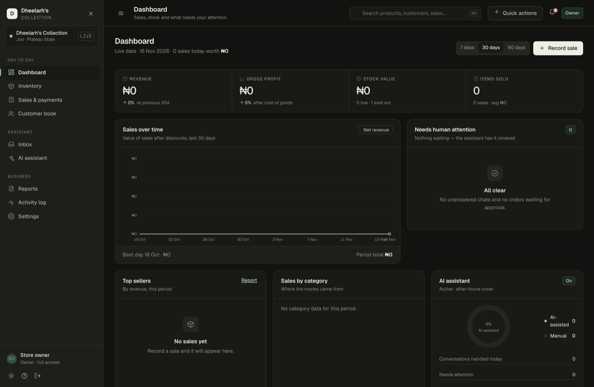
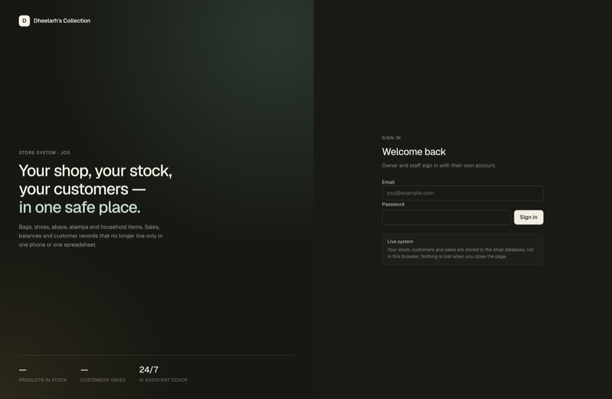
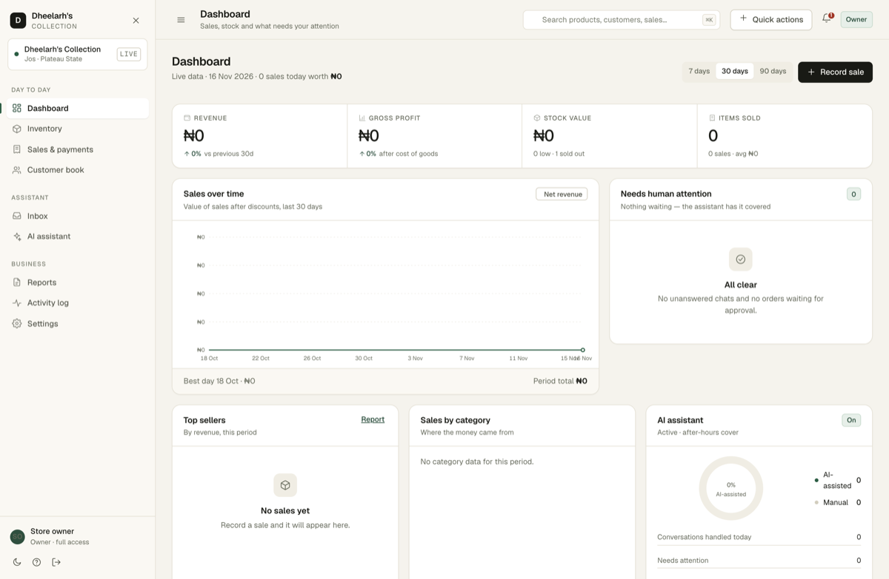
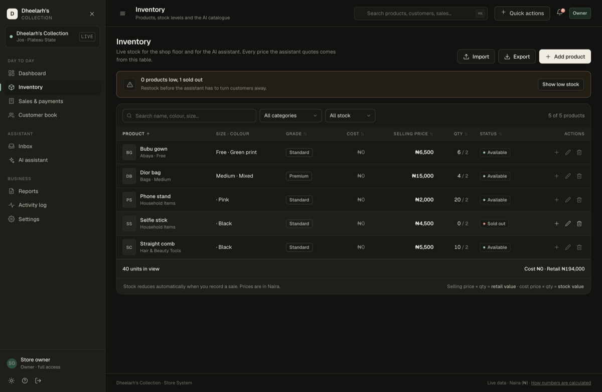
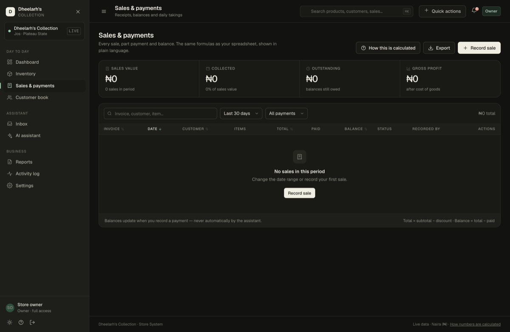
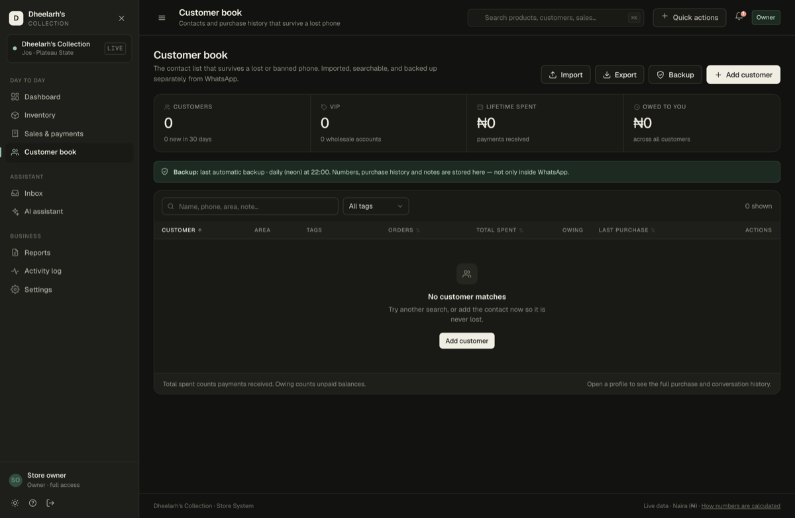
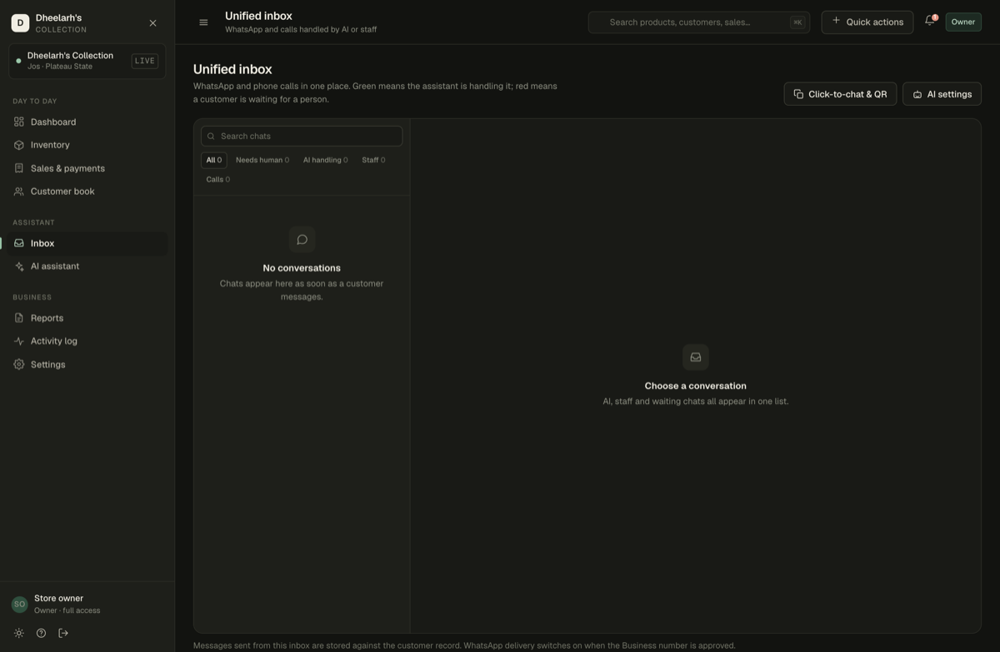
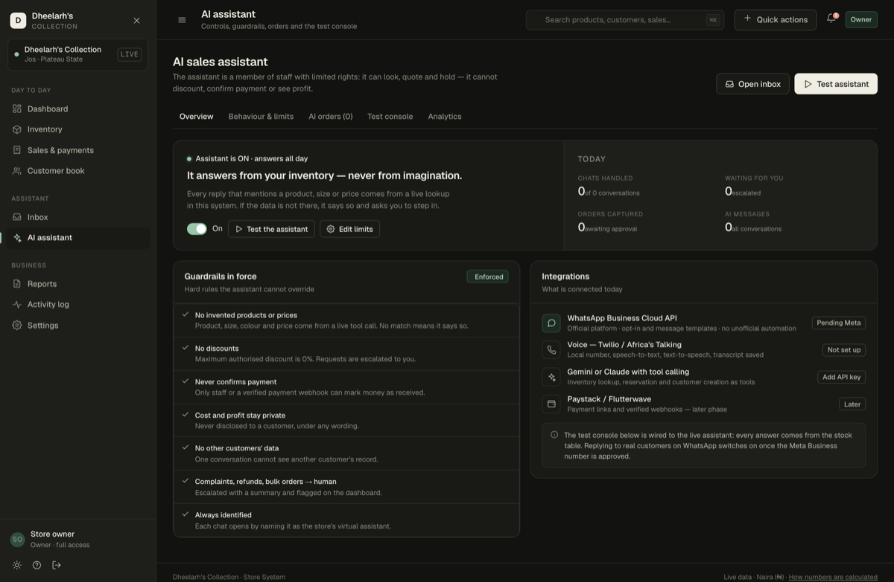
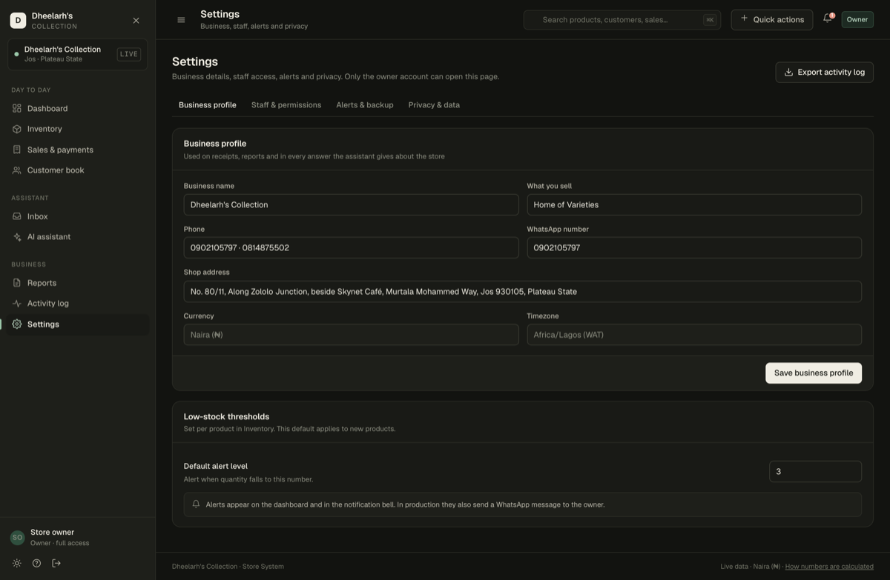

# Dheelarh's Collection — Store System

The shop's real system: stock, sales, part payments and the customer book live in a database, and the AI sales assistant answers customers from that live stock — never from imagination.

**Live:** https://dheelarhs-collection.onrender.com
**Business:** Dheelarh's Collection · "Home of Varieties" · No. 80/11 Zololo Junction, Jos, Plateau State
**Currency:** Naira (₦) · **Database:** Neon Postgres (persistent)



---

## Screens

| Sign in | Dashboard (light) |
|---|---|
|  |  |

| Inventory | Sales & payments |
|---|---|
|  |  |

| Customer book | Inbox |
|---|---|
|  |  |

| AI assistant | Settings |
|---|---|
|  |  |

Every screenshot is the deployed app reading the live database, not a mock-up.

---

## Sign in

| Account | Email | Notes |
|---|---|---|
| Owner | `muhammadabdulwadalata@gmail.com` | full access: profit, settings, staff, AI, audit log |

No password is stored in this repository. It is set in the Render environment and used once, on the first boot of an empty database. **Change it from Settings on day one** and hand the account to the client at launch.

Staff accounts are created by the owner in Settings → Staff. Server-side rules mean a staff login cannot read cost price, profit, settings or the audit log, and cannot give a discount — verified, not just hidden in the UI.

---

## What is live today

| Module | State |
|---|---|
| Login | Real accounts, scrypt hashes, database sessions, httpOnly cookie, login rate limit |
| Dashboard | Revenue, profit (or an honest "Unknown"), stock value, items sold, low stock, top sellers, needs-attention — computed from the database |
| Inventory | Add, edit, delete, restock, search, filter, sort, CSV export, **CSV/Excel bulk import** |
| Sales & payments | Record a sale, part payment, balance, receipt, delete (owner), stock decremented in a transaction |
| Customer book | Add, edit, delete, tags, notes, purchase history, **bulk import with duplicate detection** |
| Inbox | Conversations and messages stored against the customer; a staff reply takes over from the assistant |
| AI assistant | Gemini or Claude with five tools: stock lookup, alternatives, business details, draft order, escalate. Every fact comes from a SQL query |
| WhatsApp webhook | Meta verification (GET) and inbound message handling (POST) — builds the customer, the conversation and the reply |
| Staff accounts | Owner creates a login with a temporary password; deactivating cuts access immediately and kills their sessions |
| Activity log | Written by the server on every change, including AI actions |
| Settings | Business profile, policies, AI limits, alerts, privacy |
| Payments | Bank transfer only: Opay **9021905797**, Dheelarh's Collection. Only staff can mark money received |

**Profit is honest.** Until cost prices are entered, the dashboard says *Unknown — add cost prices* instead of showing takings as profit, and the database stores `profit_known = 0` for those sales.

---

## What is not connected yet

| Piece | Status | What unblocks it |
|---|---|---|
| AI API key | Engine is built; without a key every chat is handed to a human | `GEMINI_API_KEY` from [aistudio.google.com/apikey](https://aistudio.google.com/apikey) — free, no card |
| WhatsApp sending | Webhook receives and replies are written to the inbox; posting back to Meta needs the business number | `WHATSAPP_TOKEN` + `WHATSAPP_PHONE_NUMBER_ID` after Meta approval |
| Voice calls | Not built | Twilio / Africa's Talking number. The shop's policy says **no WhatsApp calls**, so this is a normal phone line |
| Product photos | URL field only | S3-compatible endpoint + access key + secret |
| Automatic backups | Neon keeps point-in-time history; scheduled dumps not set up | Neon paid plan or a nightly export job |
| Cost prices & opening stock | Unknown by design | The client's Excel |

---

## Run it locally

```bash
npm install          # only dependency: pg
cp .env.example .env # fill DATABASE_URL, OWNER_EMAIL, OWNER_PASSWORD
node server/index.js # http://localhost:3000
```

Without `DATABASE_URL` the server falls back to SQLite in `.data/`, which is for development only.

## Deploy

`render.yaml` describes the whole service, so Render can create it from this repo in one click. Environment variables: `DATABASE_URL`, `PAYMENT_ACCOUNT_NUMBER`, `WHATSAPP_VERIFY_TOKEN`, and optionally `GEMINI_API_KEY`. Pushing to `main` redeploys automatically.

Render's free plan sleeps after 15 idle minutes and takes ~1 minute to wake. $7/month on Starter removes that with no code change.

---

## Structure

```
index.html          shell: sign-in screen and app chrome
styles.css          design system, light and dark
js/data.js          shape of the in-memory store the views read
js/api.js           API layer: loads the database into that store, and every write
js/core.js          formatting, spreadsheet-accurate calculations, UI primitives
js/charts.js        dependency-free SVG charts
js/ai.js            browser-side assistant simulation for the offline demo
js/views-*.js       dashboard, inventory, sales, customers, inbox, AI, reports, settings
js/app.js           boot, sign-in, routing, events
server/index.js     HTTP server: static files + /api
server/api.js       every endpoint, validation, role rules, imports, WhatsApp webhook
server/ai.js        Gemini / Claude tool calling with guardrails
server/db.js        Postgres (production) or SQLite (local), one SQL dialect
server/schema.js    tables
server/seed.js      first-run data: the client's catalogue, prices and policies
LIVE-SETUP.md       go-live checklist, credentials, what is still missing
```

## API

All writes are validated server-side; the browser is never trusted for prices, stock or costs.

| Method | Path | Access |
|---|---|---|
| `POST` | `/api/login`, `/api/logout` | public |
| `GET` | `/api/me`, `/api/public/stats`, `/api/health` | session / public |
| `GET` `POST` `PATCH` `DELETE` | `/api/products[/:id]` | owner + staff (cost price owner-only) |
| `POST` | `/api/products/bulk` | owner + staff |
| `GET` `POST` `PATCH` `DELETE` | `/api/customers[/:id]` | owner + staff (delete owner-only) |
| `POST` | `/api/customers/bulk` | owner + staff |
| `GET` `POST` | `/api/sales` | owner + staff |
| `POST` | `/api/sales/:id/payments` | owner + staff |
| `DELETE` | `/api/sales/:id` | owner |
| `GET` `POST` | `/api/staff` | owner (`GET` for all signed-in) |
| `PATCH` | `/api/staff/:id` | owner |
| `GET` `POST` | `/api/conversations[/:id/messages]` | signed in |
| `GET` `POST` | `/api/whatsapp/webhook` | Meta (verify token) |
| `GET` `POST` | `/api/ai/status`, `/api/ai/chat`, `/api/ai/drafts` | owner |
| `GET` `PATCH` | `/api/settings` | owner (business/policies readable by staff) |
| `GET` | `/api/audit` | owner |

## Guardrails the assistant cannot break

- No invented products, prices or stock — a tool call or nothing.
- Never reveals cost price, profit, margins or another customer's record.
- Never confirms a payment; it may only give the account details.
- No discount beyond the owner's limit (currently 0%).
- Complaints, refunds, bulk or custom orders, payment confirmations and anything unclear go to a human, flagged on the dashboard.
- Says it is the store's virtual assistant, and replies by text only.

---

## Verified

Manual and scripted pass against the live Neon database: login and session, wrong password refused, unauthenticated requests refused, staff blocked from cost/profit/settings/audit/staff creation, sale with part payment (`part-paid`, balance kept), stock decremented, customer auto-created from the sale, over-selling refused, payment added to an existing sale, product create/edit/restock/delete, customer create/edit/delete, settings saved, bulk import (a "₦9,500" string parsed, an incomplete row skipped, a duplicate phone skipped), staff creation and deactivation, WhatsApp verification (`200` with the token, `403` without) and an inbound Meta payload producing a customer, a conversation and an assistant reply, and the AI fallback when no key is set. Front end driven in headless Chrome with no console errors beyond the expected `401` on the guest `/api/me` call.
