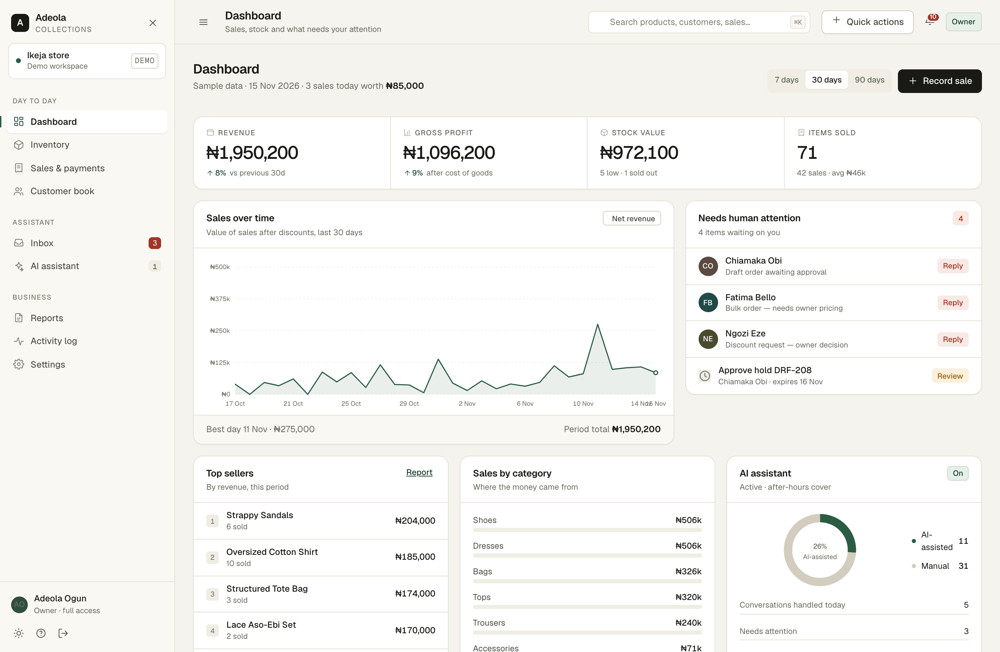
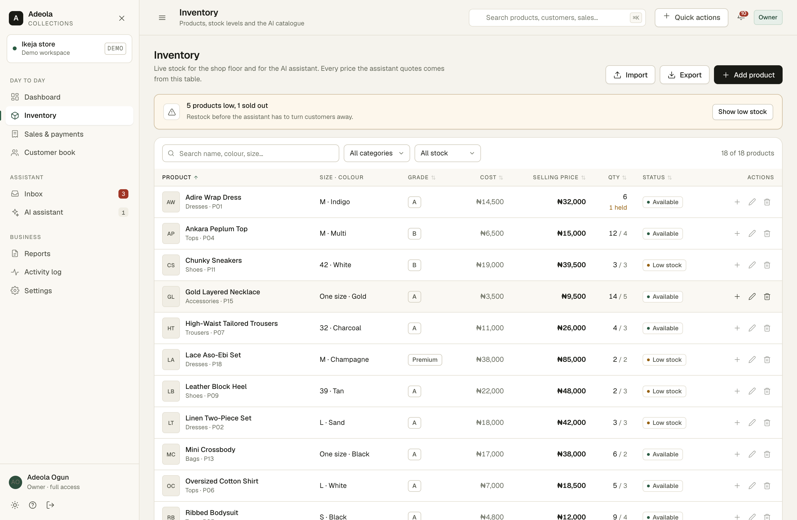
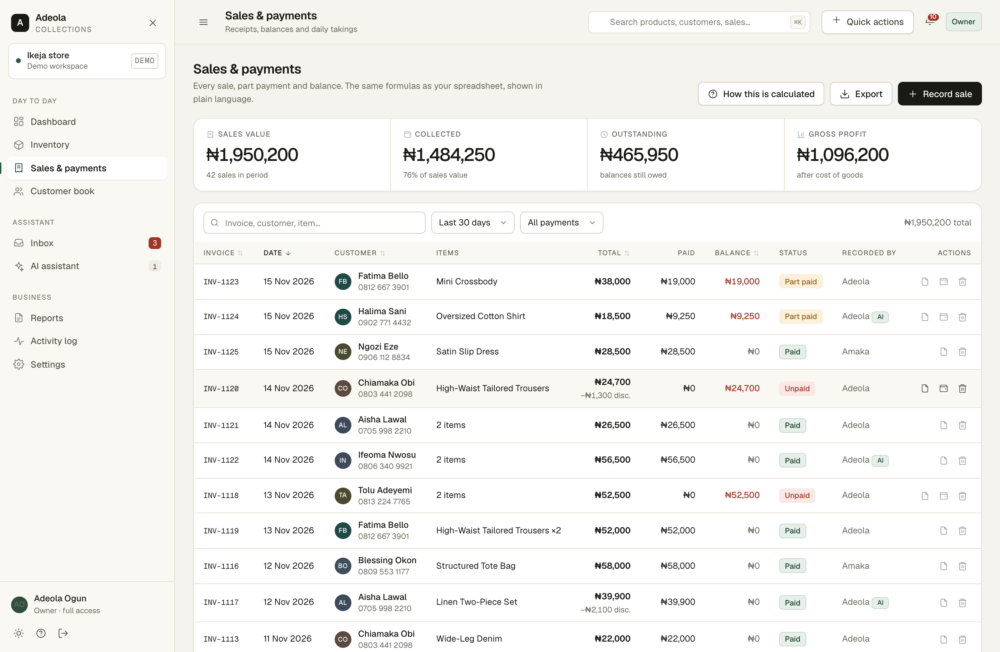
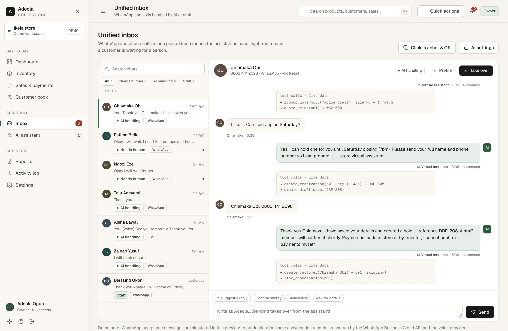
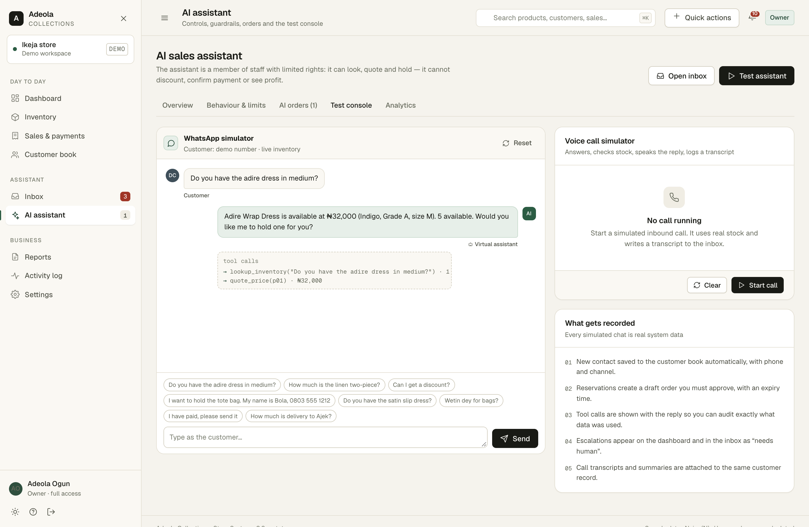
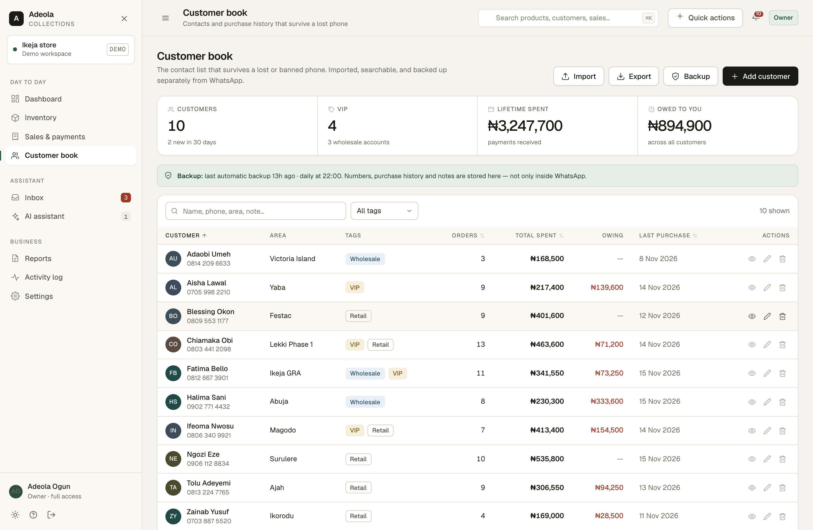
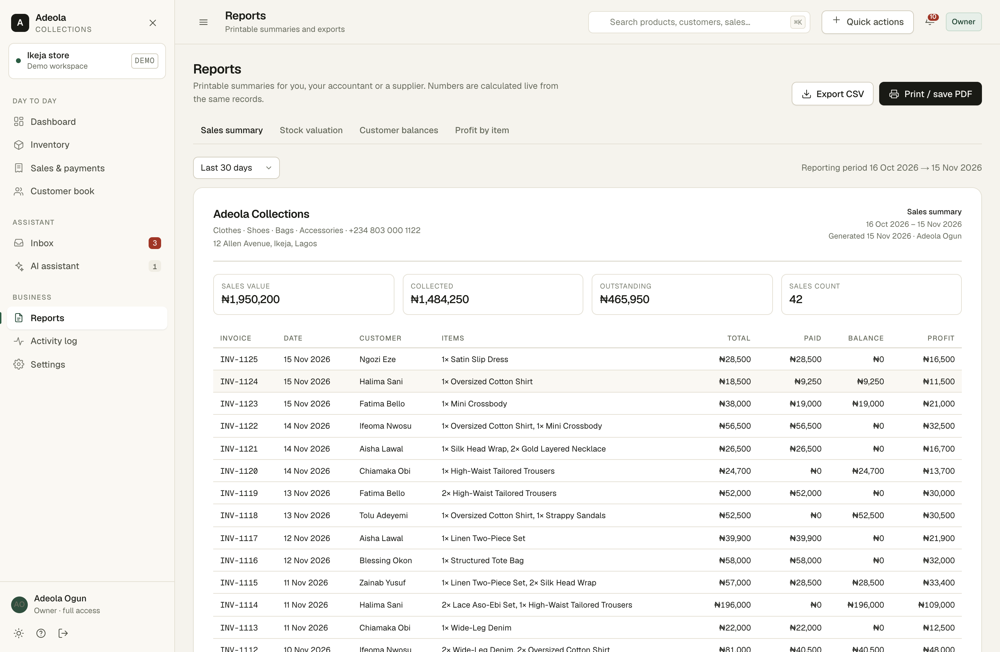
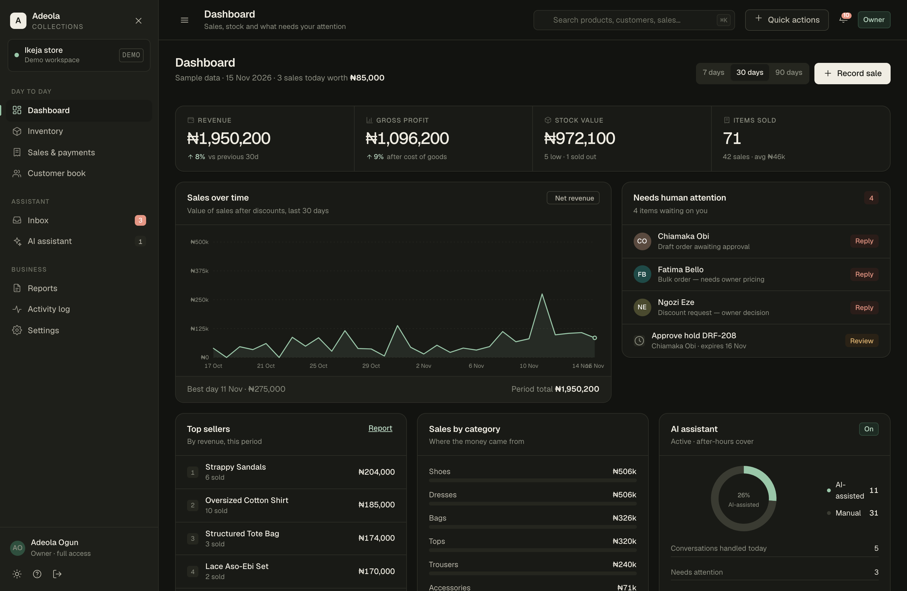
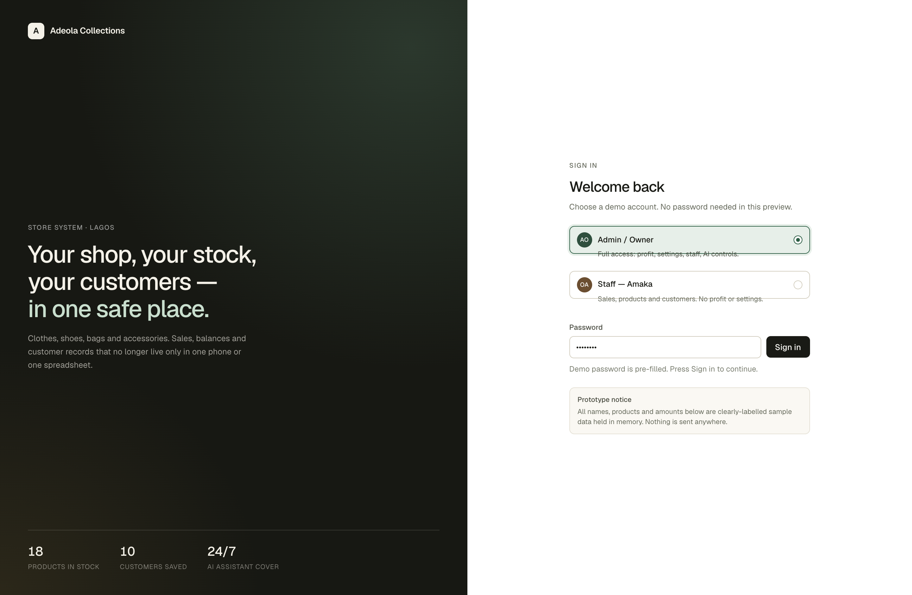
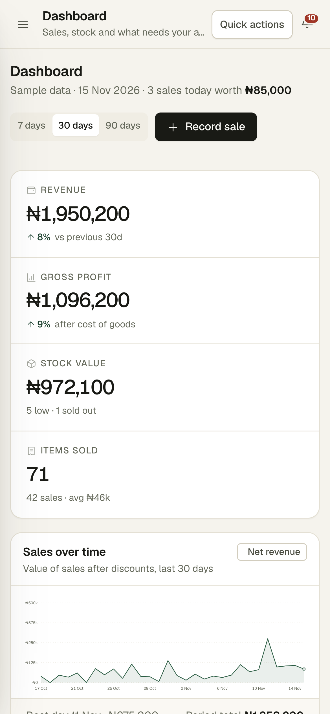

# Adeola Collections — Store System

A working store system for a fashion dealer selling clothes, shoes, bags and accessories. It replaces a loose Excel sheet with inventory, sales and part payments, a customer book that survives a lost phone, and an AI sales assistant that answers only from live stock.

Built as a single-page app with no build step, no dependencies and no install.

[](https://collection-solution-mu.vercel.app)
[](#project-structure)
[](#run-it-locally)
[](#what-this-prototype-does-not-do)

**[Open the live demo →](https://collection-solution-mu.vercel.app)**



---

## Try it in two minutes

1. Open the [live demo](https://collection-solution-mu.vercel.app).
2. Choose **Admin / Owner** (password is pre-filled) and press **Sign in**.
3. Go to **AI assistant → Test console** and send these in order:

| Type this as the customer | What you should see |
| --- | --- |
| `Do you have the adire dress in medium?` | Live price, size, colour and 5 in stock, with `lookup_inventory` and `quote_price` tool calls shown under the reply |
| `Can I get a discount?` | Refused, because the owner's limit is 0%, and escalated as needing a human |
| `I have paid, please send it` | Cannot confirm payment; only staff can mark money received |
| `I want to hold the tote bag. My name is Bola, 0803 555 1212` | Contact saved to the customer book and a draft order created for approval |
| `How much is delivery to Ajek?` | Answers from settings, never invents a fee |

Then open **AI orders** to approve the hold, **Inbox** to take over a live conversation, or press **Start call** in the voice simulator to hear an after-hours call unfold and land in the inbox as a transcript.

| Account | What they can see |
| --- | --- |
| **Admin / Owner** — Adeola | Everything: cost, profit, settings, staff, AI controls, activity log |
| **Staff** — Amaka | Sales, stock, customers and inbox. No cost, profit, settings or activity log |

The password is pre-filled: this demonstrates roles, not real authentication.

---

## Screenshots

| Inventory with live stock, holds and low-stock alerts | Sales, part payments and outstanding balances |
| --- | --- |
|  |  |

| Unified inbox — AI, staff and “needs human” in one list | AI assistant with a live tool-call trace |
| --- | --- |
|  |  |

| Customer book with balances and purchase history | Reports, printable and exportable |
| --- | --- |
|  |  |

| AI controls and guardrails | Dark mode |
| --- | --- |
|  |  |

<p align="center">
  
  
</p>

---

## What this prototype does

**Dashboard** — revenue, gross profit (owner only), stock value, items sold, low stock, top sellers, pending AI orders, AI conversations handled and a “needs human attention” list. Switch between 7, 30 and 90 days.

**Inventory** — add, edit, delete, restock, search, filter by category or status, sort any column. Cost is hidden from staff. CSV import by paste or file with a column preview, CSV export, per-product low-stock threshold, and a held count fed by AI reservations.

**Sales & accounts** — multi-item sales against a saved or brand-new customer, discounts (owner only), part payments, receipts that print or copy for WhatsApp, and a **How this is calculated** panel mapping every figure to its Excel formula.

**Customer book** — name, WhatsApp number, area, VIP/Wholesale/Retail tags, notes, purchase history, total spent, outstanding balance and last purchase. CSV import/export plus JSON backup and restore, so contacts can never be lost again.

**Unified inbox** — WhatsApp and phone calls in one list, filtered by AI, staff or needs human. Full transcripts, AI tool-call traces, take over, hand back, suggested replies, and a click-to-chat link with QR code.

**AI assistant** — on/off and after-hours scheduling, business hours, greeting, delivery and returns policies, tone, discount limit, approval threshold, escalation topics, an order approval queue, chat and voice test consoles, and analytics on what it handled and what it could not answer.

**Reports** — sales summary, stock valuation, customer balances and profit by item, with CSV export and print/save-as-PDF styles that remove all app chrome.

**Activity log** — every change with actor and time, including AI actions and guardrail refusals.

**Settings** — business profile, default low-stock level, staff accounts, permissions matrix, alerts, backup schedule, privacy controls and a demo reset.

Also: light and dark mode, `S` for a new sale, `I` for the inbox, `⌘/Ctrl K` global search across products, customers, sales and conversations, empty states with guidance, and a layout that holds down to 390px.

---

## The workflow it models

```
stock in → pricing → customer enquiry (message or call)
        → AI or staff reply → hold / draft order
        → payment → sale recorded → stock reduced → reports
```

| Step | Screen | What is recorded |
| --- | --- | --- |
| Stock in | Inventory → Add product / Restock | Cost, selling price, quantity, size, colour, grade, low-stock level |
| Pricing | Inventory | One selling price per product — the only price the assistant may quote |
| Enquiry | Inbox | Channel, customer and full message history |
| Reply | Inbox / AI console | Who replied, plus every tool call the AI made |
| Hold | AI assistant → Orders | Draft order, expiry time, separate approval step |
| Payment | Sales → Record payment | Amount, method and who confirmed it |
| Sale | Sales → Record sale | Line items, discount, paid, balance, cost at time of sale |
| Stock down | automatic | Quantity reduced when the sale is saved |
| Reports | Reports | Sales, stock valuation, balances, profit by item |

**Assumptions:** one shop, one stock location (Ikeja); Naira only, no VAT; customers are individuals or small resellers; sales can be part-paid; stock is owned outright; WhatsApp is the main channel with calls secondary; the user is not technical and mostly works on a phone.

**Risks named up front:** another WhatsApp ban (official Business Platform only, no unofficial automation), invented stock or prices (tool calls, no match means it says so), an AI confirming payment (impossible by design), overselling a held item (holds reduce available stock), losing contacts again (customer book plus CSV and backups), and margin leakage (cost and profit never reach staff or the assistant). The full risk table is in the [production roadmap](ROADMAP.md).

---

## AI rules, as implemented

**It can** look up live stock by name, size, colour or category; quote the saved selling price; say an item is sold out and offer in-stock alternatives; answer hours, location, delivery and payment questions from settings; create a 24-hour hold and a draft order; save a new contact; reply in English or simple Nigerian Pidgin.

**It cannot** invent a product, size, price, discount or policy; exceed the owner's discount limit; confirm a payment or release goods; reveal cost price, profit or another customer's details; approve its own order; or hide that it is a virtual assistant.

**It escalates** complaints and returns, refunds, wholesale and bulk pricing, custom orders, discount requests, payment claims, unanswerable questions, fully-held stock and any request for a human. Every escalation reaches the dashboard, the inbox and the activity log with a reason.

**How the numbers work** — one calculation module serves every screen, receipt and report:

```
line total    = qty × selling price
subtotal      = Σ line totals
total         = subtotal − discount
balance       = total − paid
cost of goods = Σ qty × cost price at time of sale
gross profit  = total − cost of goods
stock value   = Σ qty × cost price
```

---

## Design

Grounded in how Stripe, Linear, Mercury and Attio handle dense business software rather than a generic dashboard template: tables as the primary interface, restraint, one dominant number per card, and AI treated as a designed surface rather than a chat bubble bolted on.

One typeface family — **Geist**, with Geist Mono and tabular figures for money — on a warm ivory canvas, ink as the primary action colour and a single pine accent. Type scale: 10–11px tracked labels, 12.5–14px body, 19px page titles, 26px metrics. All colour, spacing and component states live as tokens in `styles.css`.

---

## Run it locally

```bash
git clone https://github.com/Devtec-3/collection-solution.git
cd collection-solution
open index.html          # macOS
# or: python3 -m http.server 8000  →  http://localhost:8000
```

No install, no build, no environment variables, no API keys.

---

## Deploy

The live site runs on Vercel as a static deployment:

**https://collection-solution-mu.vercel.app**

To ship a change:

```bash
npx vercel deploy --prod
```

Every file is static, so any static host (Vercel, Netlify, Cloudflare Pages, GitHub Pages) will serve it unchanged.

---

## Project structure

```
index.html          app shell, sign-in and layout
styles.css          design tokens, components, responsive and print styles
js/data.js          clearly-labelled sample data and seeded history
js/core.js          state, formatting, calculations, icons, modals, CSV
js/charts.js        dependency-free SVG charts
js/ai.js            assistant engine: intents, tool calls, guardrails
js/views-a.js       dashboard, inventory, sales
js/views-b.js       customers, inbox, AI console
js/views-c.js       reports, activity, settings
js/app.js           routing, roles, search, quick actions, events
docs/screenshots/   images used in this README
ROADMAP.md          production plan: stack, costs, WhatsApp and voice setup, training
```

---

## What this prototype does not do

Stated plainly so nothing is oversold:

- The assistant is a **deterministic local simulation**, not a live Claude model. Intents, tool calls and guardrails are real code, but no API is called.
- All data is **sample data in memory**. Refreshing restores the demo business.
- Nothing is connected to WhatsApp, telephony or a payment provider. Those integrations are designed for and simulated.
- Sign-in demonstrates roles; it is not authentication.

The phased plan to make it real — Next.js and PostgreSQL, WhatsApp Business Cloud API, a voice provider with speech-to-text and text-to-speech, Claude tool calling, Paystack or Flutterwave, monthly costs, testing checklist, staff training and Excel import — is in **[ROADMAP.md](ROADMAP.md)**.
